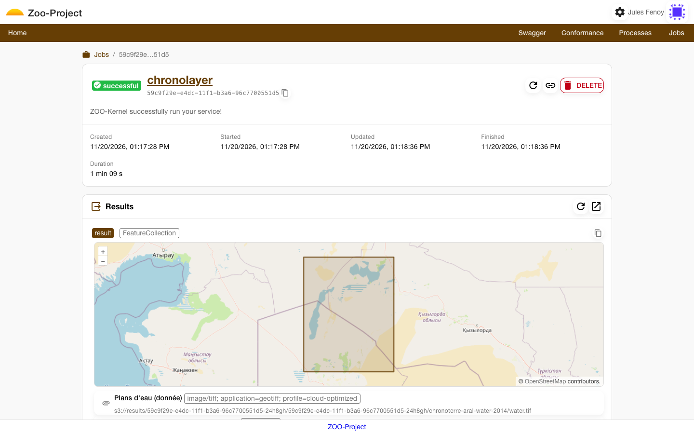
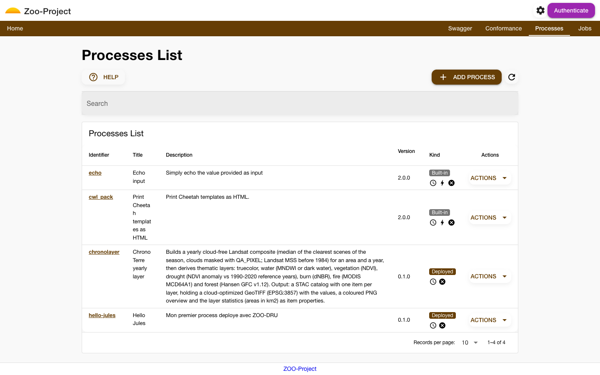
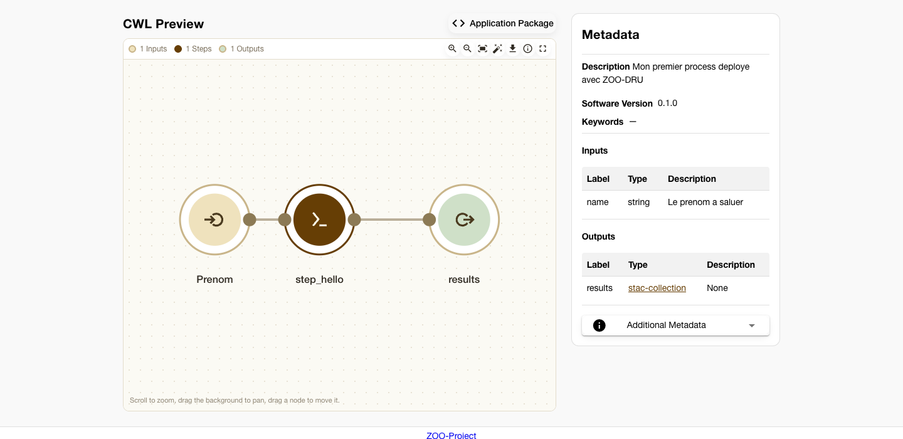
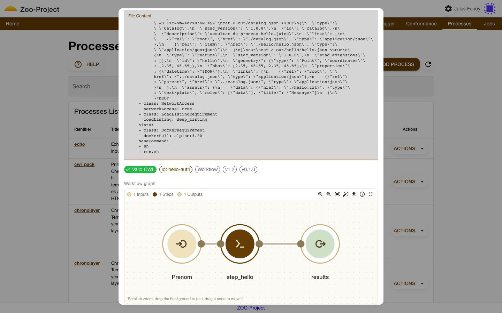
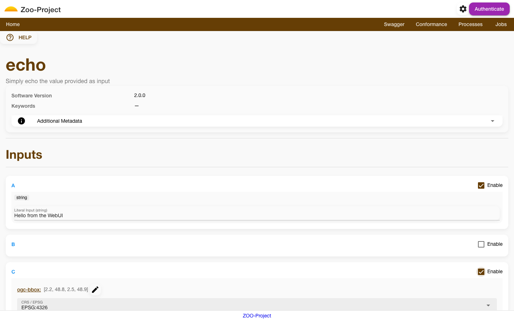
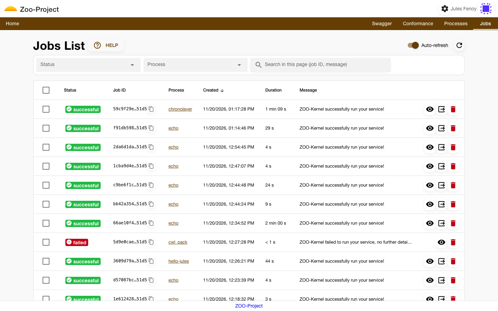
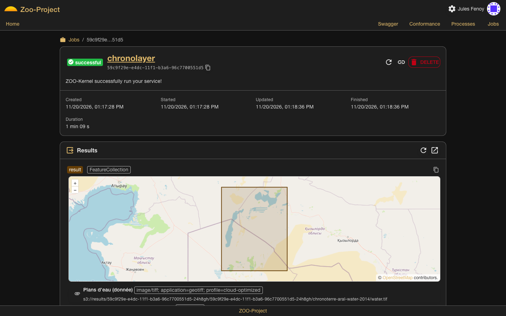

# ZOO-Project WebUI (nuxt-client)

A web client for [OGC API - Processes](https://ogcapi.ogc.org/processes/) servers, built for the
[ZOO-Project](https://zoo-project.org) and its *Deploy, Replace, Undeploy* (DRU) extension.
It lets you browse processes, deploy CWL application packages, execute processes and follow
their jobs — with an optional OpenID Connect (Keycloak) login.

Built with [Nuxt 3](https://nuxt.com), [Vue 3](https://vuejs.org), [Quasar](https://quasar.dev),
[OpenLayers](https://openlayers.org), [cwl-svg](https://github.com/rabix/cwl-svg) and
[@sidebase/nuxt-auth](https://sidebase.io/nuxt-auth).



*A finished job: status, timeline, and the STAC `FeatureCollection` it produced, drawn on the map
with the cloud-optimized GeoTIFF and PNG assets listed underneath.*

## Features

- **Home**: service metadata from the OpenAPI document, capabilities badges (conformance
  classes), landing-page links.
- **Processes**: searchable list (identifier, title, description, keywords), *Deployed* vs
  *Built-in* badge, execution modes, interactive CWL workflow graph (drawn with
  [cwl-svg](https://github.com/rabix/cwl-svg)), download of the application package.
- **Deploy / Replace / Undeploy** (OGC API - Processes Part 2): deploy from a `.cwl` file, from
  pasted text or from a URL (the server downloads it), automatic identifier detection, CWL
  validation before sending, replace an existing process, undeploy with server error details.
- **Execute**: form generated from the process description (literals, enumerations, arrays,
  complex inputs by value or reference, bounding boxes picked on a map), synchronous or
  asynchronous execution, request preview with *Copy as curl*, live progress through polling and
  WebSocket notifications, dismiss a running job.
- **Jobs**: server-side pagination, filters by status and process, auto-refresh while jobs run,
  status chips, durations, bulk delete. Job page with timeline, progress, results (JSON, links,
  images, GeoJSON/bounding boxes on a map), logs published by the server and raw documents.
- **Swagger UI** on the server's OpenAPI document, bundled server side so that the external OGC
  schemas it references resolve correctly, and the **conformance** page.
- **Authentication** with any OpenID Connect provider (Keycloak layout). Works fully anonymously
  when the server does not require a bearer token; expired sessions fall back to anonymous mode
  with a sign-in prompt.
- English and French, light and dark themes (following the system setting by default).

See the [user guide](docs/user-guide.md) for a page-by-page description, and
[docs/known-issues.md](docs/known-issues.md) for the server-side problems the UI works around.

## Screenshots

| | |
|---|---|
| **Processes** with their kind, version and execution modes  | **Workflow graph** of a selected process, drawn from its CWL package, with the inputs and outputs  |
| **Deploy dialog**: paste, upload or fetch a package, validated and drawn before it is sent  | **Execution form** generated from the process description, here a string and a bounding box  |
| **Jobs list** with status chips, durations, filters and auto-refresh  | **Dark theme**, following the system setting or forced with `?theme=dark`  |

The screenshots come from the UI deployed by the [zoo-project-dru Helm chart](https://github.com/ZOO-Project/charts)
on a local cluster, signed in through a Keycloak realm.

## Quick start

```bash
npm install
cp env_sample .env      # then edit the values, see docs/configuration.md
npm run dev             # http://localhost:3000
```

At minimum set `NUXT_ZOO_BASEURL` to the root of your ZOO-Project server (the client calls
`<NUXT_ZOO_BASEURL>/ogc-api/...`). To use the UI without any login set
`ZOO_OGCAPI_REQUIRES_BEARER_TOKEN=false`; otherwise configure the `NUXT_OIDC_*` variables.

## Configuration

All settings are environment variables read at **runtime** (no rebuild needed when they change):

| Variable | Purpose |
|----------|---------|
| `NUXT_ZOO_BASEURL` | Root URL of the ZOO-Project server as seen by the browser, e.g. `http://localhost:8080` |
| `NUXT_ZOO_INTERNAL_BASEURL` | Root URL of the server as seen by the UI container (defaults to the public one), e.g. `http://zoo-project-dru-service` in Kubernetes |
| `NUXT_WS_URL` | WebSocket URL of `websocketd` for live job notifications, e.g. `ws://localhost:8888` |
| `SUBSCRIBERURL` | URL of `publish.py` used as subscriber by asynchronous executions |
| `ZOO_OGCAPI_REQUIRES_BEARER_TOKEN` | `true` when the API refuses anonymous calls (the UI then waits for a token) |
| `ZOO_IAM_ENABLED` | `true` when an IAM (e.g. APISIX) protects the per-user API URLs |
| `AUTH_ORIGIN` / `NEXTAUTH_URL` / `NUXT_BASE_URL` | Public URL of this UI (used for the OIDC redirect) |
| `NUXT_AUTH_SECRET` | Secret used to encrypt the session cookie |
| `NUXT_OIDC_ISSUER` | OpenID Connect issuer, e.g. `https://auth.example.org/realms/zooproject` |
| `NUXT_OIDC_CLIENT_ID` / `NUXT_OIDC_CLIENT_SECRET` | Confidential OIDC client used by the server side of the UI |
| `NUXT_APP_BASE_URL` | Base path when the UI is served under a sub path (build time) |

Details, Keycloak client requirements and the Helm chart mapping are in
[docs/configuration.md](docs/configuration.md).

## Running in production

```bash
npm run build
node .output/server/index.mjs        # honours HOST / PORT
```

A multi-stage image is published as `zooproject/nuxt-client` (see `Dockerfile.nuxt`):

```bash
docker build -f Dockerfile.nuxt -t zooproject/nuxt-client:dev .
docker run --rm -p 3000:3000 --env-file .env zooproject/nuxt-client:dev
```

With Kubernetes, the [zoo-project-dru Helm chart](https://github.com/ZOO-Project/charts) deploys
the UI next to the server when `webui.enabled=true` and maps the variables above from the
`webui.*` and `iam.*` values.

## Development

```bash
npm run dev          # dev server with HMR
npm run test         # vitest unit tests (tests/)
npm run build        # production build in .output/
npx nuxi preview     # serve the production build locally (loads .env)
npm audit            # dependency advisories; see CHANGELOG.md for the current state
```

The project layout, the data flow (auth store, `useOgcApiServer`, `useJobsApi`) and the
conventions for adding a page are described in [docs/development.md](docs/development.md).
Layout and language switching notes are in [README.ui-config.md](README.ui-config.md).

## License

Apache License 2.0, see [LICENSE](LICENSE).
